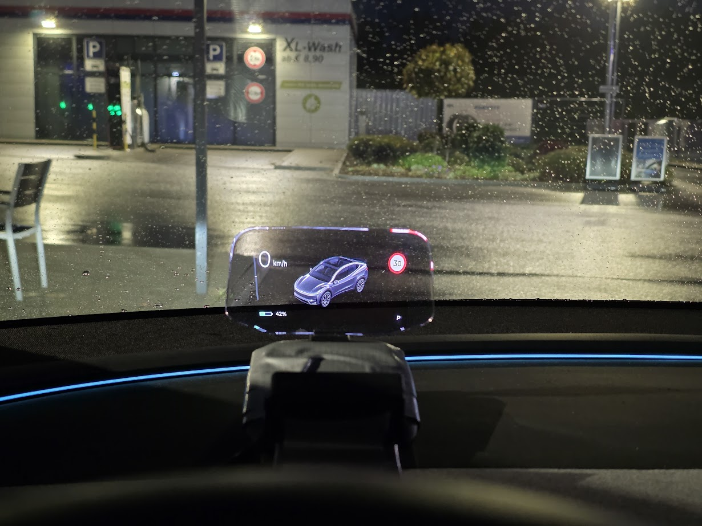
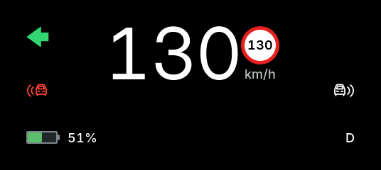
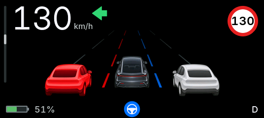
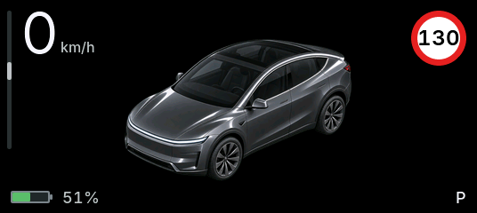
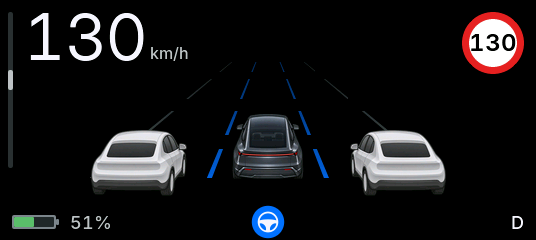
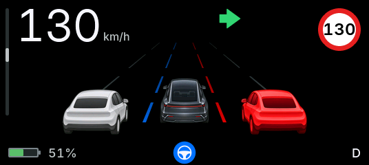
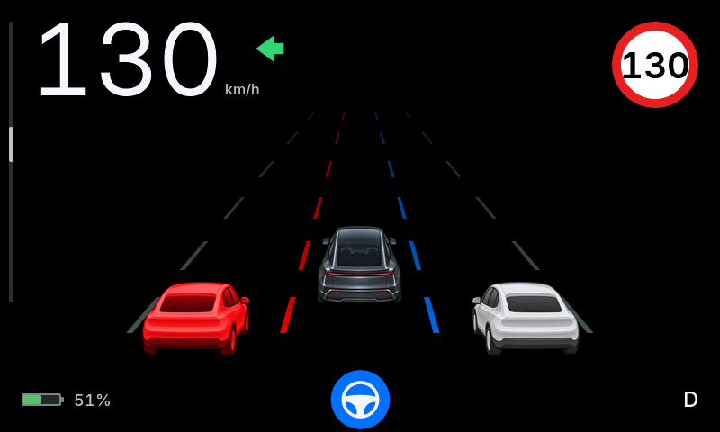

# Tesla Head-Up Display

Tesla Head-Up Display is a dedicated heads-up display for Tesla vehicles. It runs on a
LILYGO T-Display-S3 AMOLED and receives live vehicle data over Bluetooth Low
Energy (BLE) from a [DashKit](https://cardashkit.com/) CAN-bus bridge.

Official repository: [philoh-dev/tesla-lilygo-head-up-display](https://github.com/philoh-dev/tesla-lilygo-head-up-display).
The project and firmware are named **Tesla Head-Up Display**.

Licensed under the [MIT License](LICENSE). Copyright (c) 2026 philoh-dev.



Installed HUD in Park, photographed through the reflective combiner at night.



The default `true_hud` canvas keeps the driving essentials in a compact layout.
Select `road_scene` for the lane-and-vehicle visualization below.



Turn-signal arrows are [project-created vector assets](assets/icons/project/README.md)
with a familiar filled silhouette; they do not use Tesla manual bitmaps.

The firmware is written in C++ and is designed around domain-driven design
(DDD), hexagonal architecture, and automated testing.

> [!IMPORTANT]
> Tesla Head-Up Display is an independent project. It is not affiliated with or endorsed by
> Tesla, Inc. Do not allow the display to obstruct the driver's view or use it
> in a way that distracts the driver.

## Project status

The first hardware bring-up is complete. The non-touch H619 now renders the
production road-scene LVGL layout correctly on its RM67162 AMOLED, including
the production QSPI pixel path, landscape orientation, and color order. The
ESP-IDF/NimBLE adapter has also established an encrypted DashKit connection and
received notifications on hardware.

The firmware entry point, allocation-free DashKit parser, provisional Tesla
decoders, freshness-aware telemetry pipeline, persistent settings,
diagnostics, and modular dashboard are implemented and covered by host tests.
Both layouts are compiled and size-checked for ESP32-S3 in CI and run through
the shared LVGL canvas in the SDL simulator. Remaining validation focuses on
the complete live-signal set, pairing/reconnect endurance, measured frame and
resource budgets, and the final combiner/windshield installation.

## Target system

| Part | Choice |
| --- | --- |
| Vehicle interface | DashKit CAN-to-BLE bridge |
| Display controller | LILYGO T-Display-S3 AMOLED |
| MCU | ESP32-S3 |
| Display | 1.91-inch, 536 x 240, RM67162, QSPI AMOLED |
| Reused HUD hardware | C1 HUD housing and reflective combiner; LILYGO AMOLED replaces its original display unit |
| Connectivity | Bluetooth Low Energy |
| Language | C++ |
| Architecture | DDD and hexagonal architecture |

The display target is the non-touch H619 variant. Its display pin map and
transport have been confirmed on the physical board. Tesla model/year and the
remaining per-signal DashKit mappings still need to be confirmed against live
vehicle traffic. Firmware builds target ESP-IDF 5.4.4.

## Architectural direction

```text
DashKit BLE notifications
          |
          v
  BLE transport adapter
          |
          v
CAN/protocol anti-corruption layer
          |
          v
   Vehicle telemetry domain
          |
          v
 Dashboard application service
          |
          v
     Display output port
          |
          v
  LVGL/RM67162 adapter
```

The domain and application layers contain no ESP-IDF, BLE, CAN, LVGL, or
board-specific types. Those details remain in adapters behind explicit ports.

All dashboard layouts include an AMOLED pixel orbit: the content shifts by
1–2 pixels within a ±2-pixel envelope every four minutes to distribute wear
from static graphics. The same behavior runs in firmware and the simulator.

## Project structure

```text
components/domain/        Vehicle values, invariants, and settings
components/application/   Telemetry, dashboard features, and runtime orchestration
components/adapters/      DashKit protocol, Tesla decoding, BLE, NVS, LVGL/QSPI/RGB
firmware/                 ESP-IDF entry point, board profiles, layouts, and modes
simulator/                SDL transport for the shared LVGL dashboard
assets/                   Source fonts, indicator images, and vehicle artwork
tests/                    Unit, integration, replay, and canvas tests
scripts/                  Simulation, asset generation, and build tooling
docs/                     Engineering guides, screenshots, and ADRs
```

See the [architecture source layout](docs/architecture.md#source-layout) for
the component breakdown and dependency rules.

## Documentation

- [Documentation index](docs/README.md)
- [Product vision and scope](docs/product-vision.md)
- [Architecture overview](docs/architecture.md)
- [BLE connection design](docs/ble-connection.md)
- [Dashboard design](docs/dashboard.md)
- [Settings](docs/settings.md)
- [First flash and recovery](docs/first-flash-and-recovery.md)
- [LVGL/RM67162 display adapter](docs/display-adapter.md)
- [Testing strategy](docs/testing.md)
- [Hardware](docs/hardware.md)
- [Printable display cradle and Python generator](docs/display-cradle.md)
- [Adjustable optical test bench: display, mirror and combiner](docs/optical-bench.md)
- [DashKit integration](docs/dashkit-integration.md)
- [Roadmap](docs/roadmap.md)
- [Architecture Decision Records](docs/adr/README.md)

## Upstream projects

- [DashKit firmware](https://github.com/softwiredtech/dashkit-firmware) —
  ESP32-S3 firmware that reads the vehicle CAN buses and streams data over BLE.
- [DashPilot](https://github.com/softwiredtech/dashpilot) — reference Android
  and iOS dashboard applications, including vehicle-data handling concepts.
- [LILYGO Display ESP-IDF](https://github.com/Xinyuan-LilyGO/LilyGo-Display-IDF)
  — official ESP-IDF examples for LILYGO display boards.
- [LILYGO AMOLED Series](https://github.com/Xinyuan-LilyGO/LilyGo-AMOLED-Series)
  — board resources and Arduino examples for the AMOLED family.

Third-party source code is not automatically part of Tesla Head-Up Display. Before reusing
code or assets, confirm the license of the specific file and record its origin.

## Get the project

```sh
git clone https://github.com/philoh-dev/tesla-lilygo-head-up-display.git
cd tesla-lilygo-head-up-display
```

Use the `main` branch for the official project history. Build products, downloaded
dependencies, and generated local ESP-IDF configurations stay outside version control.

After updating an older checkout, configure a fresh build directory and fresh
SDKCONFIG: code, targets, include paths, environment variables and Kconfig
symbols now use the `tesla_headup` / `TESLA_HEADUP_` prefixes. Existing device
preferences return to defaults because the NVS settings namespace changed.

## Development workflow

Changes are expected to pass:

1. Host-side unit and contract tests.
2. Strict compiler-warning and whitespace checks.
3. ESP32-S3 firmware compilation.
4. Hardware integration tests for changes touching BLE, timing, or rendering.

The hardware-independent code and tests can already be built on a host:

```sh
cmake -S . -B build -DCMAKE_BUILD_TYPE=Debug
cmake --build build --parallel
ctest --test-dir build --output-on-failure
```

With SDL2 installed, launch the interactive 536 x 240 dashboard simulator:

```sh
./scripts/simulate.sh
```

The `true_hud` layout is compiled by default. Build the road-scene layout instead
with:

```sh
TESLA_HEADUP_DASHBOARD_LAYOUT=road_scene ./scripts/simulate.sh
```

On Windows, use the native launcher from PowerShell:

```powershell
$env:TESLA_HEADUP_DASHBOARD_LAYOUT = "road_scene"
.\scripts\simulate.ps1 --direct-view
```

Git Bash's `simulate.sh` delegates to that launcher automatically. It selects
Ninja and a native Zig compiler, builds in `build-simulator-windows`, and uses
SDL2's CMake package instead of requiring `pkg-config`. This avoids an existing
NMake cache in `build-simulator`. CMake, Ninja and LLVM archive tools are found
on PATH or in the standard `C:/Espressif` / `C:/Espressif-5` tool directories.
Install Zig on PATH, or place its Python distribution in the project cache:

```powershell
py -3 -m pip install ziglang==0.13.0 --target .cache/simulator-tools
```

The first Windows run downloads the pinned SDL2 development archive into
`.cache/simulator-deps` and checks its SHA-256. Later runs reuse it. LVGL is
reused from `firmware/managed_components` when available, otherwise CMake fetches
the pinned revision. The launcher copies `SDL2.dll` beside the executable.
No global PATH changes or Visual Studio/NMake installation are required.

Layout selection happens before compilation; the resulting simulator contains
only the selected canvas implementation.

### True HUD layout


`true_hud` keeps a clear 35 px border around the display, including during
pixel orbit. 100 px Inter Regular speed and its light-gray unit are horizontally centered
as one group on a fixed baseline, so changing digits do not shift them vertically.
Turn arrows occupy the top corners. The speed-limit sign sits directly above the ego-speed unit, with
18 px digits leaving at least 3 px of white padding inside the ring. The battery icon and
percentage are bottom-left, with 18 px text centered beside the 18 px-high
icon; gear uses the same text size at bottom-right, replaced by connection status
when needed.
Inter uses tabular digits. Small blind-spot icons sit between each turn arrow
and the battery/gear footer: white when occupied, red while signaling toward
that side, and hidden when clear or stale.

Launch a connected LILYGO preview on Windows:

```powershell
$env:TESLA_HEADUP_DASHBOARD_LAYOUT = "true_hud"
.\scripts\simulate.ps1 --direct-view --preview-connected --preview-speed 130 --preview-speed-limit 130
```

For firmware, configure a fresh SDKCONFIG with
`-DTESLA_HEADUP_DASHBOARD_LAYOUT=true_hud`. The `road_scene` layout remains available.

### Road-scene layout



The `road_scene` layout uses Inter with tabular digits: Regular speed, Medium
labels and units, and SemiBold speed-limit digits. The smaller speed unit sits
close to the number with aligned visible bottoms; the taller power rail aligns
with the top of the speed digits.

The `road_scene` layout adds perspective lane markings and a centered vehicle
shown directly from behind at an elevated angle. Above zero speed, the lane
markings move toward the bottom of the display at a rate derived from vehicle
speed in Drive and reverse direction in Reverse; Park and Neutral stop the
animation. The widened horizon keeps the road from appearing overly pinched
while preserving its near-vehicle width and perspective. Turn signals flank
the road. Dashes are short in the distance, grow toward the car, and preserve
gaps throughout the foreground instead of merging into solid lines. All four
boundaries share the same perspective and dash timing. Both resolutions use an upper 85% driving area and a bottom 15%
status bar: connection/battery left, Autopilot center, gear right. A fresh Park
gear hides the roads and shows the enlarged front three-quarter car, centered
and bottom-aligned above the footer. Active Autopilot
also changes the road lines from white to the indicator's blue. Both layouts
render the current speed limit as a white circular sign with a thick red border
and centered black numerals. Blind-spot occupancy places a larger, simplified
grey visualization vehicle in the matching adjacent lane, slightly behind the
ego vehicle. It changes to red while the matching turn signal is active,
highlighting a blocked lane change. The divider between that car and the ego
vehicle turns **pure red only when the matching turn signal is active**.
Occupancy alone keeps the normal white/Autopilot-blue divider. Each outer gray
boundary appears only while its adjacent lane contains a blind-spot vehicle.
Both sides use the same simplified vehicle shape, mirrored for the right side.
There is no phone-battery indicator or separate cruise/MAX readout.

| Occupied blind spots, signals off | Right signal active |
| --- | --- |
|  |  |


The left rail now displays battery power utilization: grey fills upward for
power use and green fills downward for recuperation. Each direction is scaled
against the battery's current available power limit; missing or stale BMS data
clears the fill.

| Occupied lane, no matching signal | Occupied lane, matching signal active |
| --- | --- |
|  |  |

The previews use direct-view mode, matching the image seen after the HUD is
reflected. The LilyGO road-scene driving preview shows a healthy synthetic
connection at 130 km/h with a 130 km/h limit and both blind spots occupied;
the left signal makes that vehicle and its adjacent divider red. The Park preview shows the alternate car view.

Use the arrow keys to change speed, hold Shift for 10 km/h steps, press A or D
for the left or right signal, H for the hazard warning signal, and S to turn
signals off. B cycles the blind-spot warning through clear, left, right, and
both sides. C
cycles the simulated BLE connection states, while N pauses or resumes simulated
telemetry so the real 500 ms stale-data behavior can be observed. Q toggles Autopilot. M toggles
windshield-projection mirroring, G cycles P/R/N/D, Space toggles the speed
feature, R resets, and Escape quits. Projection mirroring is enabled by default.
The simulator builds the same pinned LVGL revision and dashboard canvas as the
firmware. Its default SDL transport displays the byte-swapped RGB565 pixel stream that
would otherwise be sent to the RM67162 over QSPI. The first simulator build
downloads LVGL 9.3.0.

For deterministic screenshots, pass `--preview-no-turn-signal`,
`--preview-left-turn-signal`, or `--preview-right-turn-signal`. Add
`--preview-right-blind-spot` to move the occupied vehicle to the right lane.
Use `--preview-both-blind-spots` for both lanes, `--preview-speed 130` and
`--preview-speed-limit 130` for repeatable values, and `--preview-connected` for
the healthy battery footer. Use `--preview-regeneration` to capture the recuperation bar. In the interactive
simulator, P cycles power use, recuperation, and zero power.

The simulator screenshots are synthetic direct-view captures, not photos of a
connected vehicle or evidence of validated CAN mappings. Refresh all road-scene
README images from a built simulator with:

```sh
python3 -m pip install -r scripts/requirements-assets.txt
python3 scripts/update_readme_images.py --simulator build-simulator-windows/simulator/tesla_headup_simulator.exe
```

On Linux/macOS, use `build-simulator/simulator/tesla_headup_simulator` as the executable.
See the [screenshot catalog](docs/images/README.md) for states and dimensions.

For the **Newhaven 800×480 RGB preview**, use:

```sh
TESLA_HEADUP_DASHBOARD_LAYOUT=road_scene ./scripts/simulate.sh --rgb --direct-view
```

With `road_scene`, this uses the **entire 800×480 panel**: larger pre-sized
vehicles, six road markings per lane and edge-aligned driving information.
The upper 85% is the driving area; the bottom 15% is a transparent status bar
with connection status on the left, Autopilot centered and gear on the right.
In Park, road lines disappear and the ego car switches to a front three-quarter view.
When the link/data stream is healthy, a battery icon and fresh energy-derived
car charge replace the left connection text (`--preview-connected` shows a synthetic 51%).
It is a native arrangement, not a stretched bitmap. Its origin is fixed at `(0,0)`.
`true_hud` retains the unscaled 536×240 viewport. Add `--rgb-viewport` to use that
movable viewport with either layout; `--origin-x 132 --origin-y 120` centers it.
I/J/K/L move the viewport by one pixel; hold Shift for ten pixels.
The window title shows the origin. Coordinates are **before mirroring**;
M mirrors the whole output once, including its placement. Omit `--direct-view`
to start mirrored. All existing telemetry controls and screenshot flags work.
Screenshots are native 800×480 BMPs regardless of Retina/window scaling.
Without `--rgb`, the 536×240 LilyGO preview uses the same 85/15 road-scene structure.

For raw RGB calibration instead of dashboard telemetry:

```sh
./scripts/simulate.sh --rgb-diagnostics --direct-view
```

It cycles solid colors, checkerboard, labeled corners and viewport borders.
Space/Backspace select a pattern, A toggles cycling, M mirrors and I/J/K/L move
the viewport. Add `--diagnostic-pattern corners` to start paused. The separate
`TESLA_HEADUP_FIRMWARE_MODE=rgb_diagnostics` uses the same generator on the Newhaven,
without BLE/LVGL and with 25% default backlight brightness. See
[RGB diagnostics](docs/rgb-diagnostics.md) for build commands, previews and the
pending electrical checks. Normal firmware and the LilyGO preview are unchanged.

The firmware defaults to the **LilyGO H619**. A separate
[`devkitc_n32r16v` board profile](docs/devkitc-n32r16v.md) configures the new
32 MB octal-flash / 16 MB PSRAM DevKitC. It supports memory-only bring-up and
the Newhaven RGB adapter: two PSRAM framebuffers, native 800×480 `road_scene`
or a movable 536×240 viewport. Final-output mirroring is adjustable. See the guide for separate build commands and wiring
prerequisites; do not use the LilyGO flash scripts on that board.

The [exact Newhaven wiring guide](docs/newhaven-wiring.md) maps DevKitC GPIOs
to breakout headers and panel FPC contacts. It also covers power, grounding,
unused RGB bits, BIST and connector checks. **PWM requires a level shifter**:
the breakout pulls that pin up to 5 V; do not connect it directly to GPIO2.
Display power-on is pending regulator-capacity and actual FPC-orientation checks
described in that guide; the published regulator/panel current ratings conflict.



With ESP-IDF 5.4.4 activated, configure and build the LilyGO ESP32-S3 firmware with:

```sh
idf.py -C firmware set-target esp32s3
idf.py -C firmware build
```

`firmware/sdkconfig` is generated locally and intentionally ignored by Git.
The checked-in base, H619, and layout-specific `sdkconfig.defaults` files are
the reproducible configuration sources. Regenerate `sdkconfig` after changing
those defaults instead of editing generated values by hand.

Select **Tesla Head-Up Display RM67162 display → Dashboard layout** through
`idf.py -C firmware menuconfig` before building. The default is **True HUD**; **Road scene** compiles the alternative lane-and-vehicle
composition. Only the selected layout source is linked into the firmware.

Flash a connected board with:

```sh
idf.py -C firmware flash monitor
```

On Windows, build, size-check, flash and monitor the **LILYGO H619** with
`true_hud` by default:

```powershell
.\scripts\flash.ps1 COM3
```

The shortcut `flash-true-hud.bat COM3` runs the same launcher. Omit the port for
auto-detection. Use `-Layout road_scene` for the other canvas, `-Mode
display_self_test` for the synthetic sequence, `-NoMonitor` to skip the serial
monitor, `-BuildOnly` to compile and size-check without flashing, or `-DryRun`
to inspect commands without accessing hardware. Builds and SDKCONFIG files are
isolated by layout and firmware mode under `build-flash-h619-*`.
ESP-IDF 5.4.4 is discovered and activated automatically; `-IdfPath` accepts a
custom SDK path. See the [launcher options](docs/first-flash-and-recovery.md#windows-flash-launcher).

The existing road-scene scripts remain available from an activated ESP-IDF
command prompt:

```bat
flash-firmware.bat COM3
flash-self-test.bat COM3
```

For **Newhaven + DevKitC N32R16V**, use these separate scripts instead, one
stage at a time:

```bat
flash-newhaven-memory.bat COM3
flash-newhaven-self-test.bat COM3
flash-newhaven-firmware.bat COM3
```

Memory bring-up leaves the display/BLE disabled; keep the panel disconnected.
The RGB self-test drives the display without BLE. Normal firmware enables the
DashKit connection. Each script builds, flashes and opens the monitor with an
isolated build/config pair. Exit the monitor with `Ctrl+]` before the next
stage. Display stages require reviewed wiring/power; see the
[Newhaven Windows guide](docs/devkitc-n32r16v.md#windows-flashing-scripts).

For a first display-only bring-up without DashKit, build the compile-time
display self-test described in
[First flash and recovery](docs/first-flash-and-recovery.md#display-only-self-test).
It disables BLE, cycles deterministic telemetry through the production
dashboard pipeline, and reports measured refresh and flush-submission
performance.

## License and attribution

Original project code, documentation, and project-created artwork are
free to use, modify, and redistribute under the [MIT License](LICENSE), including
commercial use. Redistributed copies or substantial portions must retain
`Copyright (c) 2026 philoh-dev` and the MIT copyright and permission notice.

Credit the project as **Tesla Head-Up Display by philoh-dev** and link to the
[official repository](https://github.com/philoh-dev/tesla-lilygo-head-up-display)
when sharing your work; this acknowledgement is appreciated. The binding
attribution requirement is preservation of the copyright and license notice.

Third-party fonts, dependencies, and externally supplied artwork keep their
own terms and are excluded from this MIT grant. See [NOTICE](NOTICE) and the
included font licenses. The software is provided without warranty as stated
in the license.

## Contributing

Keep changes small and preserve the dependency rule: dependencies point toward
the domain. New external systems must enter through ports and adapters, and new
behavior must be accompanied by tests at the lowest useful level.
