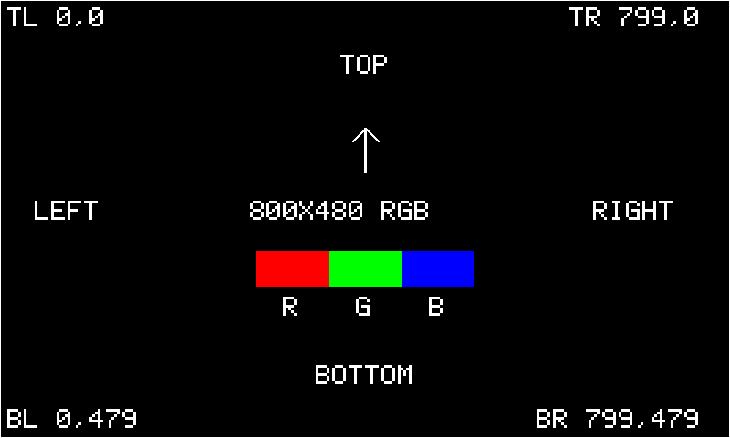

# Newhaven RGB diagnostics

Use `TESLA_HEADUP_FIRMWARE_MODE=rgb_diagnostics` to isolate the 800x480 RGB pixel path
from LVGL/dashboard rendering and BLE. The firmware and SDL preview share the
same allocation-free native RGB565 pattern generator. This is separate from
the existing animated dashboard `display_self_test` mode.

**Do not power the display until the regulator-capacity, PWM level-shifter and
FPC checks in the [wiring guide](newhaven-wiring.md) are resolved.** You can
build and inspect the simulator without connecting hardware.

## Patterns

Firmware repeats this sequence, holding each image for three seconds:

| Pattern | Expected result | Check |
| --- | --- | --- |
| `red` | Every pixel RGB565 `0xF800` | Red channel and bit wiring |
| `green` | Every pixel `0x07E0` | Green channel and bit wiring |
| `blue` | Every pixel `0x001F` | Blue channel and bit wiring |
| `white` | Every pixel `0xFFFF` | Missing/stuck color bits, uniformity |
| `black` | Every pixel `0x0000` | Residual pixels/light leakage; backlight remains enabled |
| `checkerboard` | Alternating black/white 20x20 pixel tiles | Missing rows/columns, unstable data |
| `corners` | White outermost-pixel border, labeled TL/TR/BL/BR coordinates, TOP arrow and ordered RGB swatches | Panel clipping, rotation, mirror direction |
| `viewport` | White panel edge and cyan two-pixel 536x240 viewport border with coordinates | Placement and unscaled dashboard footprint |

Solid colors and checkerboard have **no text overlays**. The serial log and
simulator title identify the active pattern. `corners` covers the entire panel;
`viewport` uses `CONFIG_TESLA_HEADUP_RGB_ORIGIN_X/Y` (default 132,0). All output, including
labels and asymmetric viewport placement, is horizontally mirrored exactly once
if selected. No AMOLED pixel orbit or driving animation moves calibration marks.

## Simulator

```sh
./scripts/simulate.sh --rgb-diagnostics --direct-view
```

This starts automatic cycling in a native 800x480 window. Controls are specific
to diagnostics:

- **Space** selects the next pattern and pauses cycling.
- **Backspace** selects the previous pattern and pauses cycling.
- **A** toggles automatic cycling, restarting the three-second dwell.
- **M** mirrors the complete output.
- **I/J/K/L** move the viewport up/left/down/right by one pixel; Shift uses ten.
- **Escape** exits.

Movement changes only `viewport`; full-panel patterns stay full-panel. The title
reports the pattern, unmirrored origin, auto/paused state and mirror state.
`--rgb-diagnostics` implies `--rgb`. Existing dashboard telemetry controls are
not active in this mode. Omit `--direct-view` to start mirrored, as in the
existing simulator. The diagnostic firmware instead defaults to direct view.

Select a pattern to start paused, or capture it without entering the event loop:

```sh
./scripts/simulate.sh --rgb-diagnostics --direct-view \
  --diagnostic-pattern viewport --origin-x 132 --origin-y 120

SDL_VIDEODRIVER=dummy ./build-simulator/simulator/tesla_headup_simulator \
  --rgb-diagnostics --direct-view --diagnostic-pattern corners \
  --screenshot /tmp/tesla_headup-rgb-corners.bmp
```

`--diagnostic-pattern` accepts only the names in the table and requires
`--rgb-diagnostics`. Screenshots contain native 800x480 pixels, independent of
window/Retina scaling. The preview does not emulate RGB electrical timing,
brightness, PSRAM bandwidth, or hardware framebuffer ownership.



## Build firmware without flashing

From the repository root in an ESP-IDF 5.4.4 environment:

```sh
idf.py -C firmware -B build-newhaven-diagnostics \
  -DIDF_TARGET=esp32s3 -DTESLA_HEADUP_BOARD_PROFILE=devkitc_n32r16v \
  -DTESLA_HEADUP_FIRMWARE_MODE=rgb_diagnostics -DTESLA_HEADUP_DASHBOARD_LAYOUT=minimal \
  -DSDKCONFIG=sdkconfig.devkitc_n32r16v.diagnostics build
```

On Windows, use one line without backslashes. Use this dedicated config/build
pair; do not reuse normal/self-test sdkconfigs. CMake rejects diagnostics on
H619 or a diagnostic sdkconfig with the wrong firmware mode. Both existing
layout selectors compile, but neither dashboard is rendered in diagnostics.

With the same flags, run `menuconfig` and open **Tesla Head-Up Display Newhaven RGB output**:

- `CONFIG_TESLA_HEADUP_RGB_DIAGNOSTIC_BRIGHTNESS`: 1-100%, default **25%**.
- `CONFIG_TESLA_HEADUP_RGB_DIAGNOSTIC_MIRRORED`: default **off**, readable on the bench.
- `CONFIG_TESLA_HEADUP_RGB_ORIGIN_X/Y`: the viewport position, not the full-panel origin.

These diagnostic preferences do not load or overwrite NVS settings. No BLE
stack or telemetry application is started. The raw generator writes only an
available PSRAM scanout buffer; the existing two-boundary ownership handoff,
timeout handling and backlight shutdown remain active. No per-pattern heap
allocation, image decoding, external font assets or LVGL object creation is required.

After the electrical checks are cleared, use the same build/config/profile
flags with `-p COM3 flash monitor` in place of `build` to flash. The three
existing Newhaven `.bat` scripts still select memory bring-up, dashboard
self-test and normal BLE firmware; none silently switches to diagnostics.

The monitor prints each pattern, origin, mirroring and requested brightness.
If output fails, firmware logs the error, disables the backlight and stops.
After raw RGB checks pass, run the separate dashboard self-test to exercise
LVGL/assets and then normal BLE firmware. Raw-pattern success does not verify
dashboard rendering, daylight readability or complete hardware compatibility.

## Automated checks

Tests verify every solid/checkerboard pixel, outer edges and corner labels,
viewport borders at center/corners/asymmetric origins, guard pixels, malformed
inputs, exact mirroring, three-second sequencing and clock rollover. SDL output
is compared pixel-for-pixel with the firmware generator for every pattern and
both mirror states. CI runs all pattern CLI smoke tests under both layouts and
cross-compiles/size-checks diagnostic firmware for both selectors.
